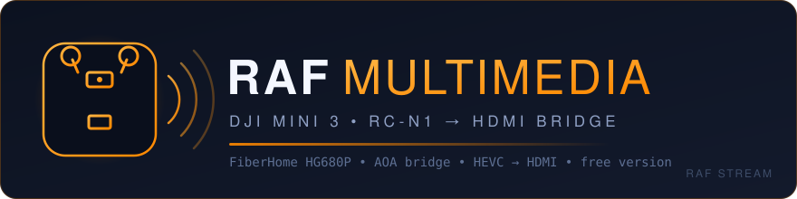
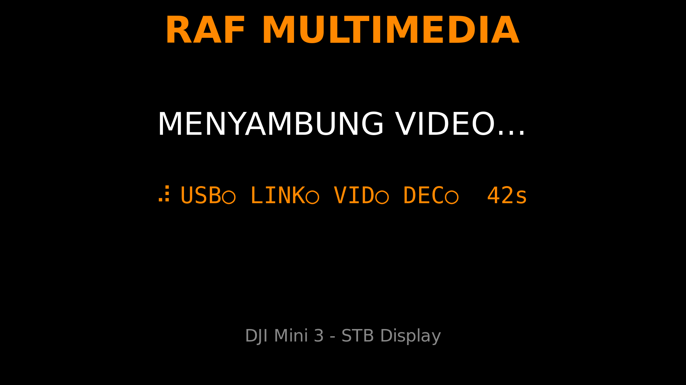

<p align="center">
  
</p>

<h1 align="center">RAF STREAM</h1>
<p align="center">
  <b>DJI Mini 3 live HDMI bridge on a &#36;15 Android TV box.</b><br/>
  RC-N1 &rarr; USB gadget &rarr; FiberHome HG680P &rarr; hardware decode &rarr; HDMI.
</p>
<p align="center">
  <a href="LICENSE"></a>
  <a href="https://github.com/ophub/amlogic-s9xxx-armbian"></a>
  <a href="https://saweria.co/raflialdi"></a>
</p>

---

**Free version — limited feature set.**

## What it does

A FiberHome HG680P set-top box (Amlogic S905X, Armbian) impersonates an
Android Open Accessory host toward the DJI RC-N1, relays the
DUML/RCLink/LogicLink session, taps the Mini 3 video stream, decodes in
hardware (meson-vdec), and drives HDMI via KMS/DRM.

- **RC plugged** = auto-switch to LIVE at the next keyframe
- **RC unplugged** = back to standby splash, no menu needed
- **DJI Fly (phone)** works concurrently via the MITM path
- Optional RTSP mirror on `:8554`

Not in this release: web UI, playlist upload, hotspot config page —
the bridge only.

## Docs that matter

| File | Contents |
|---|---|
| `RESEARCH.md` | protocol findings, captures, packet anatomy |
| `BLUEPRINT.md` | component contracts, state machines, failure matrix |
| `REGRESSIONS.md` | every production bug → root cause → fix → smoke check |
| `AGENTS.md` | two-path deploy layout, verification evidence table |
| `stb/` | install_services.sh, units, watchdog, smoke_test.sh |

## Requirements

- FiberHome HG680P (or another Amlogic S905X box) running Armbian from
  [ophub/amlogic-s9xxx-armbian](https://github.com/ophub/amlogic-s9xxx-armbian) —
  tested image:
  [`Armbian_26.11.0_amlogic_s905x_bookworm_6.12.112_server_2026.10.15.img.gz`](https://github.com/ophub/amlogic-s9xxx-armbian/releases/download/Armbian_bookworm_arm64_server_2026.10/Armbian_26.11.0_amlogic_s905x_bookworm_6.12.112_server_2026.10.15.img.gz).
  That kernel ships `raw_gadget.ko`, so the USB gadget path needs no
  out-of-tree build
- DJI RC-N1 controller + Mini 3
- SSH access to the box

## Wiring

HG680P has two USB ports with different roles — this matters:

- **USB-2** (the flashing/OTG port) = device mode, `dwc2` → **plug the
  RC-N1 here**: USB-A male ↔ USB-C male cable to the RC's **top** port
  (the cradle/phone port)
- **USB-1** = host-only (`xhci`) — cannot act as a gadget; the RC will
  never enumerate there

## Install

The box needs internet during install (apt packages + one binary
download). Everything else is automated — pick the path that fits you.

### Step 0 — get the box running

1. Flash the Armbian image above to the HG680P (USB Burning Tool works;
   see the ophub repo docs), boot it, connect it to your network.
2. Find its IP address — `ip a` on the box, your router's DHCP client
   list, or a scanner app like Fing.
3. First SSH login is `root` / `1234` — you'll be asked to set a new
   password right away.

### Path A — install from a Windows PC (recommended)

Windows can't run the installer by itself, but **Git Bash** can —
one free installer gives you `git`, `ssh` and `scp` in a Linux-style
terminal.

1. Install [Git for Windows](https://git-scm.com/download/win)
   (defaults are fine).
2. Open **Git Bash**, then:

   ```bash
   git clone https://github.com/rafall04/raf-stream.git
   cd raf-stream
   ./deploy.sh root@<stb-ip>
   ```

   Replace `<stb-ip>` with the address from step 0, e.g.
   `./deploy.sh root@192.168.1.20`. Type the box's SSH password when
   asked (a few times — the script uses several connections).
3. `deploy.sh` copies the files over SSH, runs the installer on the
   box, then runs the smoke test. Done when you see
   `SMOKE: SEMUA HIJAU`.

### Path B — install directly on the STB

If the box already has a keyboard/screen attached, or you're already
SSH'd in:

```bash
apt-get update && apt-get install -y git
git clone https://github.com/rafall04/raf-stream.git
cd raf-stream/stb
bash install_services.sh
```

Then verify:

```bash
sh /root/smoke_test.sh      # expect: SMOKE: SEMUA HIJAU
```

### After install

1. HDMI cable → TV/monitor. Within ~30 s the standby splash appears —
   this is the actual screen the display service draws:

   <p align="center"></p>

2. Plug the RC-N1 into **USB-2** (see Wiring). The display switches to
   LIVE at the next keyframe — typically a few seconds.
3. Unplug the RC → back to the splash. Replug → LIVE again.
4. Optional RTSP mirror: `rtsp://<stb-ip>:8554/dji` in VLC/ffplay.

Re-running the installer is safe — it doubles as the upgrade path.
`SKIP_INSTALL=1` / `SKIP_SMOKE=1` split `deploy.sh` stages when needed.

## When something's off

The splash's status line is the built-in diagnostic — each dot is one
layer: **USB** (gadget link), **LINK** (data from the RC), **VID**
(video packets), **DEC** (decoder). A `○` marks the stalled layer.

- Screen stays on `MENYAMBUNG VIDEO…` → RC not detected: check it's in
  **USB-2** and powered on
- `USB○` → gadget never enumerated: wrong port or bad cable (must be
  data-capable, not charge-only)
- `LINK○`/`VID○` → RC connected but no traffic: replug the RC
- Deeper check over SSH: `sh /root/smoke_test.sh` — expect
  `SMOKE: SEMUA HIJAU`; anything red is named per-check

## Support

Free to use — no paywall, no account. If the bridge saved you a
Raspberry Pi, a tip helps fund the next hardware hack:

<p align="center">
  <a href="https://saweria.co/raflialdi"></a>
</p>

## License

MIT for the code in this repository ([`LICENSE`](LICENSE)). Bundled
DJI-Link components under `stb/` are Apache-2.0 — see [`NOTICE`](NOTICE)
and [`licenses/Apache-2.0.txt`](licenses/Apache-2.0.txt). DJI, Mini 3 and
RC-N1 are trademarks of SZ DJI Technology Co., Ltd.; this project is
independent and unaffiliated.

---

<p align="center">
  <b>&copy; 2026 RAF MULTIMEDIA</b><br/>
  <sub>Built for the field — test on the ground, propellers off.</sub>
</p>
